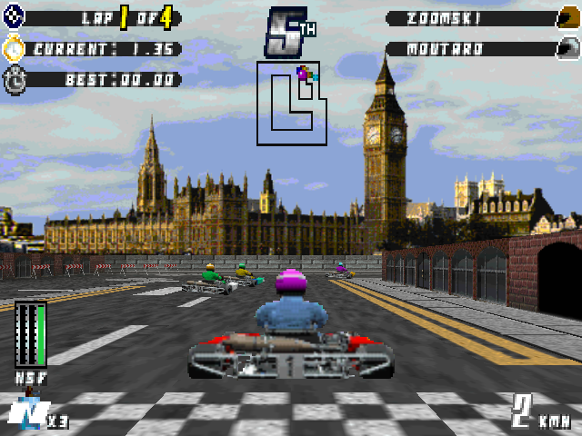
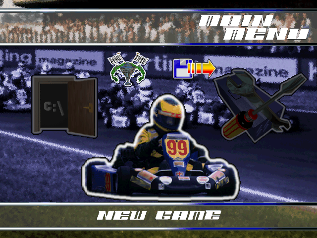

# Manic Karts for Sega Dreamcast

A native Sega Dreamcast port of the 1995 PC kart racer **Manic Karts**, built on a
decompilation of the DOS game which was part of this project.

**No game data is included.** You need your own legally owned copy of the Manic Karts
PC CD-ROM. The build reads the game's graphics, tracks, sound and music from an image of
your CD and puts them on the disc image that it makes. Please don't share any disc images
that you might build.





## AI Disclosure

This port was written with the assistance of Claude. Many hours of human testing were spent on real Dreamcast hardware, and then refining the game. If this use of AI is in conflict with your personal beliefs or values, please leave this page now. Thanks.

## Features

The DOS game's own code, decompiled and translated to C, running natively on the Dreamcast:
the same 16 tracks, karts, physics, computer drivers, power-ups, menus, seasons, shop and
all-time greats, drawn by the Dreamcast's PowerVR graphics chip at 60 frames a second, at
640x480, with the original's own hi-res menu pictures and CD music.

Version 1.0 includes:

- The whole game: single races and the three seasons (Easy, Hard and Manic Cup), with
  points, prize money, the shop and the all-time greats.
- Every kart drawn at full resolution.
- Full Dreamcast controller mapping, and the standard soft reset.
- VMU saving: six season slots, plus your records and the all-time greats.
- The original's cheat codes, typed on a Dreamcast keyboard.
- Animated trackside signs and water, as in the original.
- The Dreamcast Junkyard banners on the Hamburg tracks.

## Requirements

- [KallistiOS](https://github.com/KallistiOS/KallistiOS) with its SH-4 toolchain
  (`kos-cc`), set up and working, and [SH4ZAM](https://github.com/gyrovorbis/sh4zam)
  installed from kos-ports.
- [mkdcdisc](https://gitlab.com/simulant/mkdcdisc), to make the `.cdi` disc image.
- A C compiler (`cc`) and Python 3 (no extra packages needed).
- Your own Manic Karts PC CD-ROM, as a BIN/CUE image: **`MANICKARTS.cue`** and
  **`MANICKARTS.bin`** (one .bin holding the data track and the nine CD audio tracks).
  The build checks the game program on it (`K.EXE`, SHA-1
  `134bc3e474f2c5b5cb065d7773a442b7cbfdffbb`).

## Building

1. You must own Manic Karts for the PC. Make a BIN/CUE image of your own CD and put
   `MANICKARTS.cue` and `MANICKARTS.bin` in the top folder of this project.
2. Load the KallistiOS environment:

   ```
   source /opt/toolchains/dc/kos/environ.sh
   ```

3. Build:

   ```
   ./build.sh
   ```

The first build reads the game's files from your CD image (into `extracted/`), converts
its data and music for the Dreamcast (into `data/`), compresses the karts (a few minutes,
once), compiles the game and makes **`manic-karts.cdi`**. Later builds only redo what has
changed. Nothing is downloaded.

## Running

- **Real Dreamcast:** copy `manic-karts.cdi` to your GDEMU (or burn it to a CD-R).
- **Emulator:** open `manic-karts.cdi` in [Flycast](https://github.com/flyinghead/flycast).

## Controls

| Button | In a race |
|---|---|
| Right trigger | Accelerate |
| Left trigger | Brake |
| Y | Reverse |
| Analogue stick or d-pad | Steer |
| X | Cycle through power-ups |
| A (hold) | Activate power-ups |
| Start | Pause (Continue / Retire / Quit) |

In the menus, the d-pad or stick moves, A or Start selects and B goes back. Hold
**A + B + X + Y + Start** together at any time to go back to the title screen.

## Saving

Plug a VMU into the controller in "Port A". Seasons are saved and loaded from the LOAD GAME
and SAVE GAME screens (six slots, files `MANICKRT.001` to `MANICKRT.006`). Your lap records,
the all-time greats and the ORIEL cheat are saved automatically (file `MANICKRT.SYS`).

## Cheats

Plug a Dreamcast keyboard into any controller port and type a code on any menu screen. Without
a keyboard, enter the code as a driver name instead. Typing a code again turns it off
(except ORIEL).

| Code | Cheat |
|---|---|
| EXETER | Super grip always on. |
| MANICMARTIN | Nitro always on. |
| KEBLE | Fuel never runs out. |
| ORIEL | Go karting - any track: choose which track a season starts on (saved to the VMU). |
| SOMERVILLE | No collisions at all. As in the original, laps no longer count, so the race can only be retired. |
| BRASENOSE | +$10,000. |
| NUFFIELD | Nothing visible, as in the original. |
| TRINITY | Nothing visible, as in the original. |

## Your own pictures

The build pastes any picture in `mods/` over the game's own floor and wall sheets. Name it
after the sheet and where its top left corner goes: `mods/RAWALLS1@0,92.png` goes onto
`RAWALLS1.PCX` at x 0, y 92. Any colours work (each is matched to the nearest of the track's
256), and pure green (0, 255, 0) is see-through on walls. Walls are drawn 1.6 times taller
than they are wide, so draw lettering squashed to match. The Dreamcast Junkyard banners in
`mods/` are an example.

## Layout

| Folder | Contents |
|---|---|
| `src/` | The game: the decompiled DOS game's code (karts, computer drivers, power-ups, race, seasons, menus, on-screen display, sound) and its drawing. |
| `include/` | The platform interface and maths (SH4ZAM). |
| `platform/dc/` | The Dreamcast side: KallistiOS video, sound, controllers, keyboard and VMU. |
| `tools/` | What the build uses: reading your CD image, unpacking `KART.DAT`, and converting the game's data and music. |
| `mods/` | Your own pictures for the tracks. |
| `art/` | The port's own art (the VMU save icon). |
| `images/` | The screenshots on this page. |

## Credits

- [KallistiOS](https://github.com/KallistiOS/KallistiOS) and the Dreamcast homebrew
  community, [SH4ZAM](https://github.com/gyrovorbis/sh4zam),
  [mkdcdisc](https://gitlab.com/simulant/mkdcdisc), [Flycast](https://github.com/flyinghead/flycast).
- The banners in `mods/` are for [The Dreamcast Junkyard](https://www.thedreamcastjunkyard.co.uk/).
- Manic Karts is (c) Manic Media Productions / Virgin Interactive. This project is not
  affiliated with or endorsed by them.
- This is a non-commercial preservation project and is not affiliated with or endorsed by Sega.
